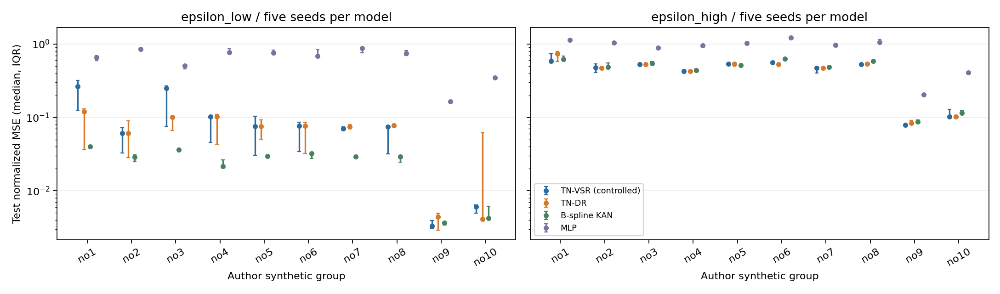
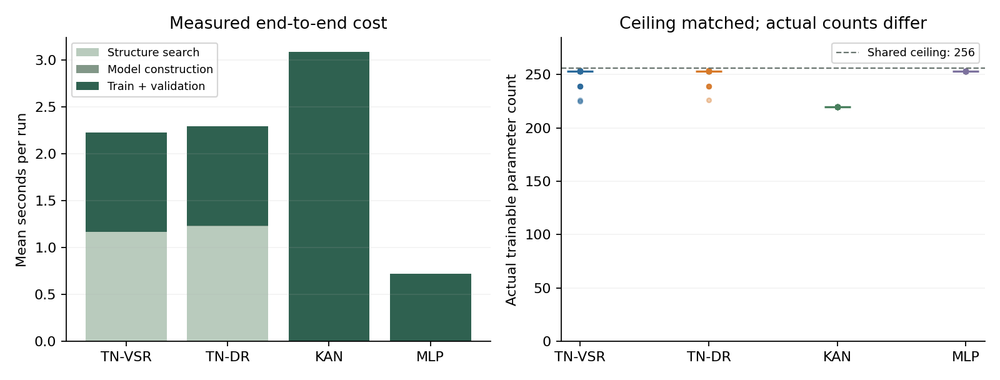
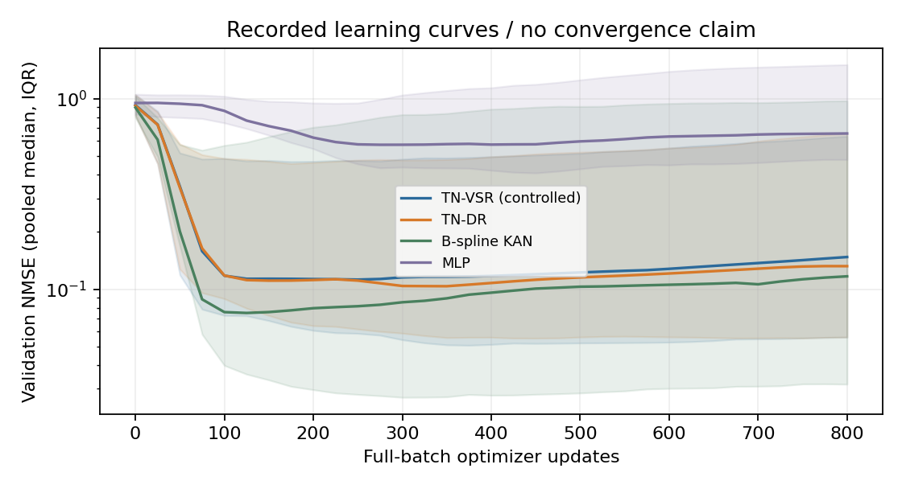

# TN、DR-ISR 改进 TN 与 KAN：端到端实验验收报告

日期：2026-11-04。思路与验收：张轩瑞；实现与实验：Codex。

已完成 **400 次真实网络训练**，覆盖作者 20 组合成数据、5 个种子、4 种模型。其中两组 TN 共执行 200 次结构搜索。失败/中断状态共 0 次，全部保留。

这次新增的是完整链路：训练数据上的公式搜索 → 将幂次参数化为神经元 → 网络训练 → 验证集选检查点 → 独立测试。**这是受控合成数据实验，不是原论文 16 个真实数据集的复现。**

## 三组比较的直接结果

每个比较含同任务、同种子的配对；测试 NMSE 越低越好，绝对差 ≤1e-8 视为平。

| 比较（左侧为被考察方法） | 配对数 | 胜 / 平 / 负 | 成对 NMSE 差的中位数 |
|---|---:|---:|---:|
| TN-VSR（受控复现） vs B-spline KAN（efficient-kan） | 100 | 51 / 0 / 49 | -0.000312614 |
| TN-DR（实验版） vs B-spline KAN（efficient-kan） | 100 | 54 / 0 / 46 | -0.00158275 |
| TN-DR（实验版） vs TN-VSR（受控复现） | 100 | 33 / 42 / 25 | 0 |
| TN-VSR（受控复现） vs MLP | 100 | 100 / 0 / 0 | -0.530115 |

这里合并了不同合成任务的配对，属于描述性汇总，不是统计显著性检验。须同时看下面每个任务的结果；不能把一组数据上的胜率解释为普遍优越性。

## 按噪声拆开看，结论不同

误差比为同任务/种子下左侧 NMSE / 右侧 NMSE 的几何平均，低于 1 有利于左侧。它用于展示差距大小，不能替代统计检验。

| 噪声组 | 比较 | 胜 / 平 / 负 | 误差几何平均比 |
|---|---|---:|---:|
| epsilon_low | tn_vsr vs kan | 11 / 0 / 39 | 2.1284 |
| epsilon_low | tn_dr vs kan | 14 / 0 / 36 | 2.0737 |
| epsilon_low | tn_dr vs tn_vsr | 20 / 18 / 12 | 0.97427 |
| epsilon_high | tn_vsr vs kan | 40 / 0 / 10 | 0.92995 |
| epsilon_high | tn_dr vs kan | 40 / 0 / 10 | 0.93623 |
| epsilon_high | tn_dr vs tn_vsr | 13 / 24 / 13 | 1.0068 |

**本轮判断：低噪声下当前 KAN 基线通常更好；高噪声下两组多项式 TN 通常更好，但差距较小。DR 相对 TN-VSR 的改变很有限，不能声称已经获得稳定算法改进。** 42 组 TN 配对找到了相同幂次，权重初始化和训练结果完全相同。这种差异与模型偏置、结构搜索和固定训练设置都可能有关，本轮没有单独建立因果归因。

## 每个任务的测试 NMSE 中位数

NMSE = 原始单位 MSE / 训练标签方差。低/高噪声沿用作者数据文件命名；所有组使用数据中现有的带噪标签，不能将误差解释为对无噪真函数的误差。

| 数据集/任务 | TN-VSR | TN-DR | KAN | MLP |
|---|---:|---:|---:|---:|
| epsilon_low/no1 | 0.266626 | 0.120488 | 0.0402004 | 0.658957 |
| epsilon_low/no2 | 0.0610733 | 0.0604874 | 0.028605 | 0.847835 |
| epsilon_low/no3 | 0.25199 | 0.10099 | 0.0361351 | 0.507465 |
| epsilon_low/no4 | 0.102422 | 0.102488 | 0.021471 | 0.76665 |
| epsilon_low/no5 | 0.0758524 | 0.0758524 | 0.0297793 | 0.758233 |
| epsilon_low/no6 | 0.0768604 | 0.0768604 | 0.032118 | 0.686259 |
| epsilon_low/no7 | 0.0703451 | 0.0745589 | 0.0289763 | 0.880646 |
| epsilon_low/no8 | 0.0744012 | 0.0777237 | 0.029303 | 0.755162 |
| epsilon_low/no9 | 0.00329777 | 0.00443009 | 0.00367139 | 0.16376 |
| epsilon_low/no10 | 0.00601108 | 0.00408087 | 0.0042341 | 0.34921 |
| epsilon_high/no1 | 0.584938 | 0.740338 | 0.618811 | 1.14033 |
| epsilon_high/no2 | 0.481693 | 0.4721 | 0.488575 | 1.04649 |
| epsilon_high/no3 | 0.529586 | 0.529586 | 0.548142 | 0.885693 |
| epsilon_high/no4 | 0.427787 | 0.427747 | 0.442573 | 0.955437 |
| epsilon_high/no5 | 0.539682 | 0.539682 | 0.513501 | 1.03254 |
| epsilon_high/no6 | 0.559518 | 0.531622 | 0.62879 | 1.22693 |
| epsilon_high/no7 | 0.470785 | 0.470785 | 0.488822 | 0.970991 |
| epsilon_high/no8 | 0.530927 | 0.540663 | 0.588509 | 1.06507 |
| epsilon_high/no9 | 0.0789802 | 0.0836848 | 0.0877898 | 0.204557 |
| epsilon_high/no10 | 0.102882 | 0.102882 | 0.115398 | 0.408591 |

完整 IQR、每次种子的公式/幂次和训练曲线见 [测量报告](../evidence/neural-v1/report.md)、[逐次结果](../evidence/neural-v1/runs.jsonl)。

## 计算代价与公平性

统一参数量上限 256、Adam 学习率 0.01、全批量 800 次更新。按上限选择各模型的最大隐藏宽度，实际参数数目不同；这是容量上限对照，不是精确同参数或同 FLOPs 对照。

| 方法 | 参数量中位数（范围） | 搜索秒数中位数 | 训练/验证秒数中位数 | 端到端秒数中位数 |
|---|---:|---:|---:|---:|
| TN-VSR（受控复现） | 253（225–254） | 1.021 | 1.015 | 2.035 |
| TN-DR（实验版） | 253（226–254） | 1.161 | 1.047 | 2.214 |
| B-spline KAN（efficient-kan） | 220（220–220） | 0.000 | 3.033 | 3.038 |
| MLP | 253（253–253） | 0.000 | 0.710 | 0.710 |

全部端到端计时之和约 **833.8 秒**。CPU、2 个 PyTorch 线程；组别顺序固定打乱，运行顺序已保存。端到端时间含搜索、模型构造和训练/验证；共同数据准备及最终测试预测不计入。不是同时间预算比赛。

TN 两种搜索均花费 1500 个训练集向量求值单位，包含完整适应度、候选探针和上下文计算。KAN 和 MLP 没有结构搜索，不虚构等量搜索成本；它们的额外优势或限制必须结合实际耗时解释。

## 原版与改进版具体是什么

- TN-VSR：沿用作者的多项式神经元聚合形式与参数初始化方式，安全重写实现，替代原代码的 exec/eval。公式搜索采用共享、有限深度/次数的 VSR 实现，并非作者原始 GP 脚本原封不动运行。
- TN-DR：同样的搜索空间、初始种群、预算、参数化与优化；只在交叉中用残差和上下文导数对供体排序。找到的数值系数转为自由训练权重，结构中的非零幂次决定神经元。
- KAN：有 MIT 许可及指纹的 efficient-kan 实现，三次 B-spline、网格大小 5、固定网格，未加入符号分支、剪枝、网格更新或超参数搜索。不能代表所有 KAN 变体或最佳 pykan 配置。
- MLP：普通线性层–Sigmoid–线性层，检查这些任务是否确实需要更合适的神经元。

两层参数化 TN 可以串联，但本次只搜索多项式幂次，尚未实现一般的内外层复合结构发现、自适应文法或动态记忆。幂次相同的 TN-VSR/TN-DR 配对使用相同权重初始化与训练过程，其结果相同是预期行为。

## 核验与复现

- 5 项神经网络专用测试：作者聚合形式及梯度、B-spline/模型梯度与参数上限、向量上下文导数/预算尾部、归一化隔离、验证检查点与测试隔离。
- 保存所有模型权重、测试预测、训练曲线、公式、分割索引、归一化参数、环境和源码/数据哈希。
- 使用 `python verify_neural.py evidence/neural-v1` 重建网络并回放全部模型的训练/验证/测试误差，同时核验预测、预算、参数上限和文件校验和。实际检查输出见交付时的验证记录。
- 跨平台回放采用逐点预测 rtol=1e-5、atol=1e-5（归一化输出单位）；绝对容差沿用 PyTorch 1.13 对 float32 的默认量级。首轮 Linux 回放曾在旧 atol=1e-6 下发现约 3.6e-6 的差异；训练/验证/测试 NMSE 与原单位 MSE 的独立阈值未改动，归档模型与结果未改动。验证器会报告全部模型的最大逐点绝对偏差。
- 用 Python 3.10 执行 `python run_neural.py` 可重新训练；本机复用 G:/Task_based_neurons/.venv，不修改原环境或原项目。

## 可以和不可以从本轮推出什么

可用于判断当前有限预算下，残差引导是否改善了同一种 TN 搜索/训练管线，以及这条管线与当前 KAN 基线的实际差距。不能据此证明整个 TN 框架优于/劣于 KAN，或复现作者论文的最佳性能。

限制包括：单一固定数据划分、每任务仅五个种子、共享固定学习率和有限更新数、参数上限而非精确匹配、结构搜索存在代理目标与网络训练目标的差异；没有多数据划分验证、统计检验、等时预算、全面调参、干净真函数或外推测试。不从结果挑选种子，不因某个模型落后而事后换配置。下一轮应针对已记录的失败机制单独立实验。

## 最终交付复核

核验日期：2026-11-05。已测实现提交 `243769f4fbd29ba1db7396e5c01b29e463ef0b44`。[GitHub 自动验证记录](https://github.com/12313Q2312/DR-ISR/actions/runs/41844951945) 的原有 GP 与新增神经网络两个任务均成功。

9 项 GP 测试、5 项神经网络测试、400 个归档模型的 1200 项误差回放全部通过。Linux 对 Windows 归档的最大逐点预测绝对偏差为 `3.606081e-06`（归一化输出），在记录的单精度容差内；实验指标未改动。

完整核验摘要和原始日志中的通过记录保存在 [neural_ci_verification.json](neural_ci_verification.json)。本节及相关交付记录的后续更新只涉及文档，不改变上述已测实现和模型。
